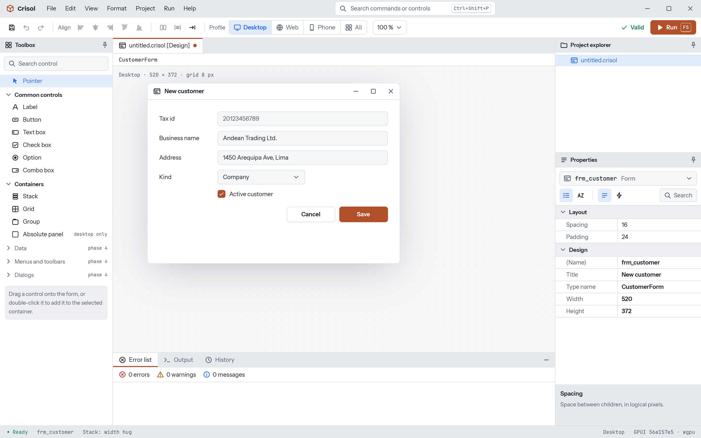

# Crisol

Crisol is a visual form designer for Rust, in the spirit of Windows Forms. Drag controls onto
a form, set their properties, connect their events, and get plain Rust code for
[GPUI](https://github.com/zed-industries/zed/tree/main/crates/gpui), the GPU-accelerated UI
framework behind the Zed editor.

> Status: early development (0.1). Windows is the first platform.



## Download

Download `crisol-vX.Y.Z-setup.exe` from the latest
[release](https://github.com/Josuesp1620/crisol/releases) and run it. It installs Crisol with
Start menu and desktop shortcuts, and opens `.crisol` and `.crisolproj` files with a
double-click. A portable zip is attached too.

To build and run your projects from Crisol, install Rust from [rustup.rs](https://rustup.rs).

## Projects

File › New project creates a Cargo project ready to run:

```
billing/
├── billing.crisolproj        the project: name and forms
├── Cargo.toml
└── src/
    ├── main.rs               opens the startup form
    └── forms/
        ├── mod.rs            kept current by Crisol
        ├── main_form.crisol  the form you design
        ├── main_form.generated.rs   rewritten on every save
        └── main_form_events.rs      your code, only ever extended
```

## The designer

- **Toolbox**: drag a control onto the form, or double-click it to add it to the selected
  container.
- **Canvas**: click to select (Ctrl+click adds to the selection), drag to move or reorder,
  drag the handles to resize; guides show what the control aligns with.
- **Properties**: values that differ from the default are bold and are the only ones saved.
  The lightning button lists events; clicking an empty one connects it to a method.
- **Error list, Output, History**: validation (including portability and accessibility
  warnings), what the designer did, and every undoable step.
- **Run (F5)** opens the form with working controls; **Generate code (Ctrl+Shift+B)** writes
  the Rust files next to the `.crisol` file.

Shortcuts: Ctrl+Shift+N new project, Ctrl+O open, Ctrl+S save, Ctrl+Shift+S save all,
Ctrl+Shift+A add form, F7 view code, F5 preview, Ctrl+F5 run project, Ctrl+Shift+B build,
Ctrl+Z / Ctrl+Y undo and redo, Ctrl+C / Ctrl+V / Ctrl+D copy, paste and duplicate, arrows
to nudge, Del delete, Esc select the container, Ctrl+Shift+P command palette.

## How it works

- A form is a `.crisol` file: the single source of truth, stored as canonical JSON so Git
  diffs stay clean.
- The designer draws the form directly from that file, so every change shows at once.
- Crisol generates `form_name.generated.rs` with the form struct and a trait with one method
  per event. You implement that trait in your own file, which Crisol never rewrites.

```rust
impl CustomerFormEvents for CustomerForm {
    fn save(&mut self, window: &mut Window, cx: &mut Context<Self>) {
        // your code
    }
}
```

## Repository

| Path | What it holds |
|---|---|
| `crates/crisol-model` | The form document and the `.crisol` format |
| `crates/crisol-catalog` | Controls, their properties, events and defaults |
| `crates/crisol-commands` | Reversible commands and undo history |
| `crates/crisol-engine` | Selection, hit testing, dragging and snapping |
| `crates/crisol-codegen` | Code generation (Rust for GPUI) |
| `crates/crisol-ui` | Crisol's own GPUI components and theme |
| `crates/crisol-render` | Draws a document with GPUI |
| `apps/crisol-designer` | The designer (`crisol.exe`) |
| `apps/crisol-cli` | Command line (`crisol-cli check`, `crisol-cli generate`) |

## Build

Every toolchain runs in Docker:

```bash
make images         # build the Docker images
make test           # tests of the crates without a user interface
make lint           # formatting and clippy
make windows-build  # crisol.exe for Windows (debug, cross-compiled)
make screenshots    # render the designer to target/screenshots/ without a screen
```

The command line works on any form:

```bash
crisol-cli check examples/customer/customer.crisol
crisol-cli generate examples/customer/customer.crisol --out examples/customer/src/forms
```

Windows release builds are produced by GitHub Actions when a `vX.Y.Z` tag is pushed.

## License

[MIT](LICENSE)
